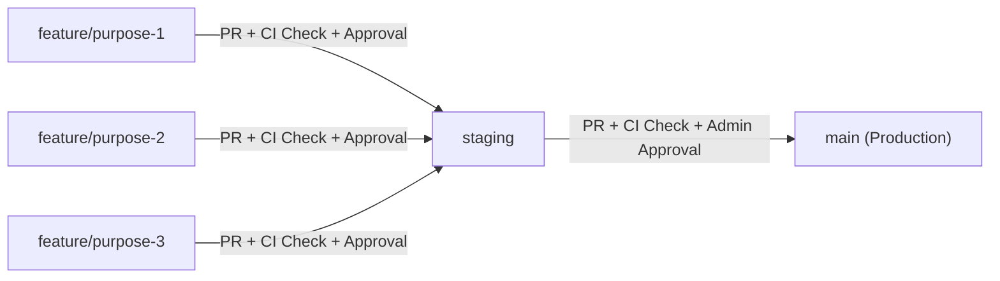

# EcoPartnerHub - Team Branching Strategy & Governance

This document outlines the branching model, pull request workflow, automated quality checks, and GitHub branch protection configuration for all contributors to **EcoPartnerHub**.

---

## 1. Branch Architecture Overview

The repository enforces a strict, multi-tiered branching strategy designed for stability, code quality, and reliable production deployments:



| Branch | Purpose | Direct Push Allowed? | Who Can Merge? | PR Target Requirements |
| :--- | :--- | :---: | :---: | :--- |
| **`main`** | **Production-ready code.** Only thoroughly reviewed, pre-tested staging code lives here. | ❌ **No (Untouchable)** | Lead / Admin only | PR from `staging` only; CI passed; Approved |
| **`staging`** | **Integration / Staging.** Consolidated pre-production branch where all active features meet. | ❌ **No** | Lead / Admin only | PR from `feature/<purpose>`; CI passed; Approved |
| **`feature/*`** | **Active development.** One branch per feature or purpose. | ✅ (Author only) | N/A (Temporary) | Must branch off latest `staging` |

---

## 2. Branch Naming Standard

All developers must adhere to the naming convention:

```bash
feature/<purpose>
```

### Examples of Valid Branch Names:
- `feature/user-authentication`
- `feature/partner-directory`
- `feature/header-navigation`
- `feature/database-connection`

### Examples of Invalid Branch Names:
- ❌ `john/my-code`
- ❌ `update`
- ❌ `fix1`
- ❌ `test`

> [!IMPORTANT]
> The automated GitHub Actions CI pipeline validates the branch name format on every pull request. If the branch name does not match `feature/<purpose>` when targeting `staging`, the CI check will fail automatically.

---

## 3. Step-by-Step Developer Workflow

### Step 1: Start from Updated `staging`
Always branch off the latest integration code:
```bash
git checkout staging
git pull origin staging
git checkout -b feature/your-feature-name
```

### Step 2: Develop and Test Locally
Work on your feature and test locally with Next.js:
```bash
npm run dev
```

Before opening a PR, run the local verification suite:
```bash
npm test
```
This runs:
1. `npm run type-check` (TypeScript strict validation)
2. `npm run lint` (ESLint code standards)
3. `npm run build` (Next.js production build)

### Step 3: Commit and Push
```bash
git add .
git commit -m "feat(scope): describe what was implemented"
git push -u origin feature/your-feature-name
```

### Step 4: Open a Pull Request to `staging`
1. Navigate to GitHub: [EcoPartnerHub Repository](https://github.com/xspacewebdevelopment-dot/EcoPartnerHub)
2. Click **New Pull Request**.
3. Set **Base**: `staging` ← **Compare**: `feature/your-feature-name`.
4. Fill in the PR template checklist.
5. GitHub Actions will run automated quality checks.
6. The lead reviewer will review the code and approve.
7. Merge into `staging`.

---

## 4. Staging to Production (`main`) Release Workflow

Once the features consolidated in `staging` are verified:

1. Create a Pull Request with **Base**: `main` ← **Compare**: `staging`.
2. Title: `Release: Staging to Main (vX.X.X)`.
3. GitHub Actions executes the full validation pipeline:
   - Validates that the source branch is strictly `staging`.
   - Runs `type-check`, `lint`, and `build`.
4. Lead reviewer / repository administrator reviews and approves the release PR.
5. Merge into `main`.
6. Production deployment triggers automatically (e.g. Vercel / Cloud Host).

---

## 5. Free-Tier GitHub Branch Protection Setup Guide

Because **EcoPartnerHub** is a **Public Repository**, GitHub provides branch protection rules and repository rulesets for **100% free**.

Follow these exact steps in GitHub to make `main` untouchable and enforce approvals:

### Part A: Protect the `main` Branch (Untouchable & Immutable)

1. Open your repository on GitHub: `https://github.com/xspacewebdevelopment-dot/EcoPartnerHub`
2. Click **Settings** (top navigation tab) → **Branches** (left sidebar under *Code and automation*).
3. Under **Branch protection rules**, click **Add branch ruleset** (or **Add rule**).
4. Fill in the rule:
   - **Branch name pattern**: `main`
5. Enable the following checkboxes:
   - ✅ **Require a pull request before merging**
     - ✅ **Require approvals**: Set to `1` (or higher)
     - ✅ **Dismiss stale pull request approvals when new commits are pushed**
     - ✅ **Require review from Code Owners**
   - ✅ **Require status checks to pass before merging**
     - ✅ **Require branches to be up to date before merging**
     - Search and select status checks:
       - `Next.js Quality Gates (Types, Lint, Build)`
       - `Validate Branch & PR Rules`
   - ✅ **Require linear history** (keeps git history clean and prevents messy merge commits)
   - ✅ **Do not allow bypassing the above settings** (applies even to repository admins)
   - ✅ **Restrict deletions** (prevents accidental branch deletion)
   - ✅ **Block force pushes** (prevents rewriting history)
6. Click **Create** or **Save changes**.

---

### Part B: Protect the `staging` Branch

1. In **Settings** → **Branches**, click **Add rule** again.
2. Fill in:
   - **Branch name pattern**: `staging`
3. Enable:
   - ✅ **Require a pull request before merging**
     - ✅ **Require approvals**: Set to `1`
     - ✅ **Dismiss stale pull request approvals when new commits are pushed**
   - ✅ **Require status checks to pass before merging**
     - ✅ **Require branches to be up to date before merging**
     - Search and select:
       - `Next.js Quality Gates (Types, Lint, Build)`
       - `Validate Branch & PR Rules`
   - ✅ **Block force pushes**
   - ✅ **Restrict deletions**
4. Click **Create** or **Save changes**.

---

## 6. Summary Checklist for Admins

- [x] Initial commit with Next.js server, TypeScript, ESLint, Tailwind CSS
- [x] `main` branch created
- [x] `staging` branch created
- [x] CI pipeline configured in `.github/workflows/ci.yml`
- [x] PR template added in `.github/pull_request_template.md`
- [x] Code owners file added in `.github/CODEOWNERS`
- [ ] Apply Part A & Part B branch protection rules in GitHub Settings

