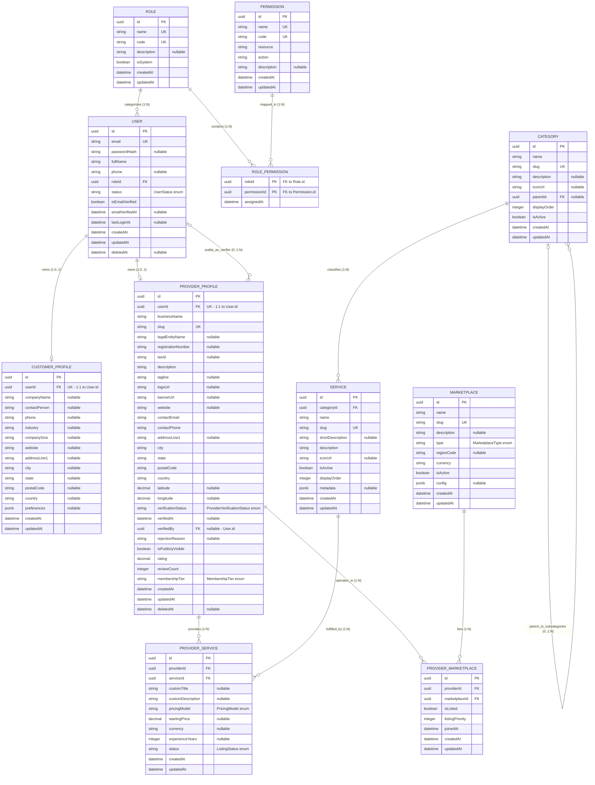
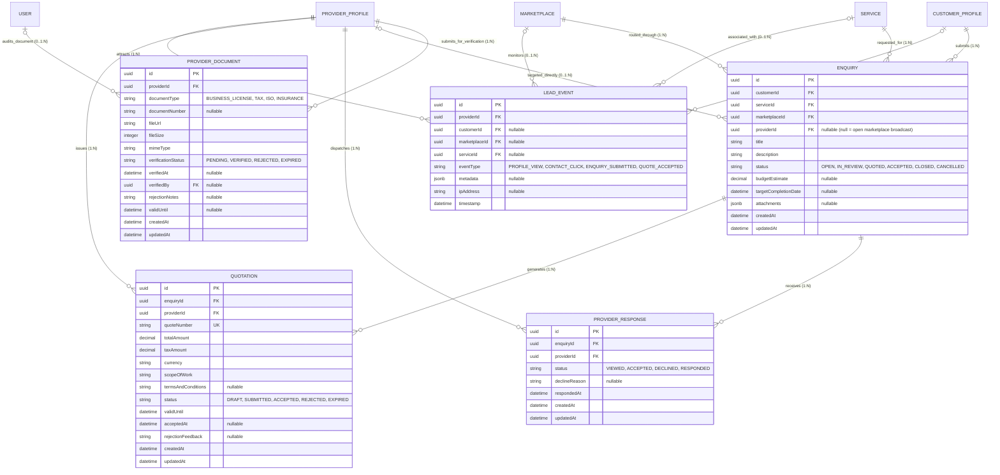

# EcoPartnerHub - Entity Relationship (ER) Diagrams

> **Document Status**: Architectural Review Draft  
> **Database Engine**: Neon PostgreSQL (Serverless)  
> **ORM Modeling**: Prisma ORM  

---

## 1. Core Architecture ER Diagram (10 Core Entities)

The diagram below documents the 10 core database entities, primary keys (PK), foreign keys (FK), unique constraints (UK), data types, and exact relational cardinalities.

---

## 2. Cardinality Legend & Relationship Breakdown

| Relationship | Cardinality Syntax | Verbal Description | Referential Integrity Action |
| :--- | :---: | :--- | :--- |
| **`ROLE` to `USER`** | `||--o{` | One Role can belong to zero or many Users; One User has exactly one Role. | `ON DELETE RESTRICT` (Cannot delete a Role while Users are assigned to it). |
| **`ROLE` to `ROLE_PERMISSION`** | `||--o{` | One Role has zero or many Permission assignments. | `ON DELETE CASCADE` (Removing a Role revokes all its permission grants). |
| **`PERMISSION` to `ROLE_PERMISSION`**| `||--o{` | One Permission is mapped across zero or many Roles. | `ON DELETE CASCADE` (Removing a Permission removes it from all Roles). |
| **`USER` to `CUSTOMER_PROFILE`** | `||--o|` | One User has zero or exactly one CustomerProfile. | `ON DELETE CASCADE` (Deleting a User removes their customer profile). |
| **`USER` to `PROVIDER_PROFILE`** | `||--o|` | One User has zero or exactly one ProviderProfile. | `ON DELETE CASCADE` (Deleting a User removes their provider profile). |
| **`USER` (Auditor) to `PROVIDER_PROFILE`** | `|o--o{` | One User (auditor) can verify zero or many ProviderProfiles. | `ON DELETE SET NULL` (Deleting an auditor user keeps the verified record intact). |
| **`CATEGORY` to `CATEGORY` (Self)** | `|o--o{` | One Category can have zero or one parent Category; and zero or many subcategories. | `ON DELETE RESTRICT` (Cannot delete a parent Category if child subcategories exist). |
| **`CATEGORY` to `SERVICE`** | `||--o{` | One Category contains zero or many Services; One Service belongs to exactly one Category. | `ON DELETE RESTRICT` (Cannot delete a Category if it contains active Services). |
| **`PROVIDER_PROFILE` to `PROVIDER_SERVICE`** | `||--o{` | One Provider offers zero or many Services. | `ON DELETE CASCADE` (Deleting a Provider deletes their service listings). |
| **`SERVICE` to `PROVIDER_SERVICE`** | `||--o{` | One Service is offered by zero or many Providers. | `ON DELETE RESTRICT` (Cannot delete a Service if active Provider listings depend on it). |
| **`PROVIDER_PROFILE` to `PROVIDER_MARKETPLACE`** | `||--o{` | One Provider participates in zero or many Marketplaces. | `ON DELETE CASCADE` (Deleting a Provider removes their marketplace listings). |
| **`MARKETPLACE` to `PROVIDER_MARKETPLACE`** | `||--o{` | One Marketplace hosts zero or many Providers. | `ON DELETE RESTRICT` (Cannot delete a Marketplace if providers are actively listed). |

---

## 3. Extended Architecture: Future Entities Integration

The following diagram illustrates how the future entities identified in **TASK 3** (`ProviderDocument`, `Enquiry`, `ProviderResponse`, `Quotation`, and `LeadEvent`) cleanly connect with the core schema without breaking existing tables.

---

## 4. Architectural Notes on Diagram Integrity

1. **Decoupling RBAC from Profiles**:
   A `User` links to `Role` for security and permissions, while linking to `CustomerProfile` or `ProviderProfile` for business data. This ensures administrative and security decisions remain isolated from business entity schemas.
2. **Strict Verification Boundary**:
   Notice that `PROVIDER_DOCUMENT` links to `PROVIDER_PROFILE`, and status changes require an auditor (`USER.id`). No automatic triggers promote a provider to `APPROVED`.
3. **Multi-Marketplace Join Topology**:
   `PROVIDER_MARKETPLACE` allows one provider to belong to multiple regional or vertical hubs with independent visibility toggles (`isListed`) and custom priorities (`listingPriority`).
