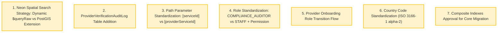

# EcoPartnerHub - Provider Management API Architectural Review & Refinement

> **Document Status**: Architectural Review & Gap Analysis  
> **Target Framework**: Next.js 16 (App Router, Node.js runtime, TypeScript)  
> **ORM & Database**: Prisma ORM (`@prisma/client` ^6.19.3) / Neon PostgreSQL (Serverless)  
> **Domain Lead**: Tathagata Mahapatra (Provider Management, Services, Marketplaces, Discovery & Schema Coordination)  
> **Coordinating Leads**: Akshay (Auth), Om Prakash (Verification), Krishna (Leads & Enquiries), Architecture Lead  
> **Primary Input Document**: [provider-api-plan.md](file:///home/tathagata-mahapatra/EcoPartnerHub/docs/database/provider-api-plan.md)  
> **Related Design Specs**: [database-design.md](file:///home/tathagata-mahapatra/EcoPartnerHub/docs/database/database-design.md) | [er-diagram.md](file:///home/tathagata-mahapatra/EcoPartnerHub/docs/database/er-diagram.md) | [team-review-checklist.md](file:///home/tathagata-mahapatra/EcoPartnerHub/docs/database/team-review-checklist.md)

---

## Executive Summary

This document performs a critical architectural review of [`docs/database/provider-api-plan.md`](file:///home/tathagata-mahapatra/EcoPartnerHub/docs/database/provider-api-plan.md) prior to database migration and route implementation. It identifies and resolves structural inconsistencies, corrects the distance-sorting search architecture, designs the necessary audit-history infrastructure for provider compliance, standardizes roles and permissions, identifies missing indexes and validation rules, demarcates cross-team ownership, and consolidates all architectural decisions requiring team sign-off.

---

## 1. Identified Inconsistencies & Structural Gaps

A thorough cross-examination between the folder structure, endpoint catalog, authorization matrix, and Prisma code examples in `provider-api-plan.md` revealed several critical discrepancies:

### 1.1 Inconsistencies Between Folder Structure and Endpoint Catalog

| Endpoint / Path | Folder Structure (Section 2) | Endpoint Catalog (Section 3) | Issue & Required Resolution |
| :--- | :--- | :--- | :--- |
| `GET /api/providers/[id]/services` | Defined in tree: `src/app/api/providers/[id]/services/route.ts` | **Missing** from Section 3.1 & 3.3 tables | **Omission**: While documented in the file tree, this endpoint was omitted from the catalog tables. Must be cataloged as a public read endpoint that lists active services for an approved provider by ID. |
| `GET /api/services/categories/[id]` | Defined in tree: `src/app/api/services/categories/[id]/route.ts` (`GET \| PATCH \| DELETE`) | Listed in Section 3.3 for `PATCH` & `DELETE` only | **Omission**: `GET /api/services/categories/[id]` is missing from Section 3.1 (public catalog). Clients need to fetch single category metadata and child subcategories. |
| `PATCH /api/services/[id]` | Defined in tree: `src/app/api/services/[id]/route.ts` | Section 3.3 lists `PATCH` and `DELETE` | **Catalog Alignment**: Needs explicit cataloging in Section 3.1 for `GET` (public) and Section 3.3 for `PATCH` / `DELETE` (admin). |

### 1.2 Path Parameter Ambiguity: Catalog ID vs. Join Entity ID

In `provider-api-plan.md`, the routes for managing provider offerings and marketplace participation are specified as:
- `/api/providers/me/services/[serviceId]`
- `/api/providers/me/marketplaces/[marketplaceId]`

**The Architectural Conflict:**
- In the database schema, `ProviderService` has its own primary key `id: UUID`, alongside foreign keys `providerId: UUID` and `serviceId: UUID` (with `@@unique([providerId, serviceId])`).
- In Section 4.2 Endpoint B response, both keys are returned:
  ```json
  "services": [
    {
      "id": "f5a1c9e8-1111-2222-3333-444455556666",        // ProviderService PK
      "serviceId": "a1b2c3d4-0000-0000-0000-000000000001"   // Service (Catalog) FK
    }
  ]
  ```
- Naming the dynamic segment `[serviceId]` causes confusion among frontend and backend developers: does the route expect the **Catalog Service ID** or the **ProviderService Listing ID**?
- **Resolution**:
  - If addressing by catalog service ID: Prisma must query via the compound unique index `where: { providerId_serviceId: { providerId, serviceId } }`.
  - If addressing by listing ID: rename the folder segment to `[providerServiceId]` (or `[listingId]`), and query via `where: { id: providerServiceId, providerId }`.
  - **Standardized Decision**: We standardize on **Catalog Service ID** in the URL path (`[serviceId]`) to allow intuitive REST resource addressing (`/api/providers/me/services/[serviceId]`), and execute Prisma queries using the compound key:
    ```typescript
    where: {
      providerId_serviceId: {
        providerId: currentProvider.id,
        serviceId: params.serviceId,
      },
    }
    ```
  - The same applies to `/api/providers/me/marketplaces/[marketplaceId]`, using `where: { providerId_marketplaceId: { providerId, marketplaceId } }`.

### 1.3 Role Inconsistency on Provider Onboarding (`POST /api/providers`)

- **The Conflict**:
  - In Section 3.2: `POST /api/providers` is described as "Onboard new provider profile for authenticated user".
  - In Section 5.2 (Auth Matrix): `POST /api/providers` requires role `PROVIDER` or `ADMIN`.
- **The Chicken-and-Egg Problem**:
  - When an unregistered user creates an account with Akshay's auth system, their role is typically `CUSTOMER` or an unassigned/base user role.
  - If `POST /api/providers` strictly requires the `PROVIDER` role, a new user can never onboard themselves because they do not yet have the `PROVIDER` role!
- **Resolution**:
  - `POST /api/providers` must be accessible to any authenticated user who has an active `User` account (`status === 'ACTIVE'`) and does **not** already have a `ProviderProfile`.
  - Upon successful creation of the `ProviderProfile`, the user's role must be transitioned to `PROVIDER` (coordinating with Akshay's RBAC system) within the same atomic transaction.

### 1.4 Country Name vs. Country Code Bug in Auto-Enrollment (Section 6.2)

- In Section 6.2 of `provider-api-plan.md`, the onboarding transaction attempts to auto-enroll the provider into a default marketplace:
  ```typescript
  const defaultMarketplace = await tx.marketplace.findFirst({
    where: { regionCode: data.country, isActive: true },
  });
  ```
- In Section 4.2 Endpoint C, `data.country` is submitted as `"India"` (or full country name), whereas `Marketplace.regionCode` is defined as `VARCHAR(10)` (holding ISO codes like `"IN"`, `"EU"`, `"APAC"`).
- Comparing `regionCode: "India"` will always return `null`, silently breaking auto-enrollment!
- **Resolution**: Require ISO 3166-1 alpha-2 or alpha-3 country codes (`countryCode: "IN"`) in onboarding payloads, or store ISO codes in `ProviderProfile.country` (e.g., `"IN"`).

### 1.5 Disconnect Between Search Parameters and Prisma Implementation

- Section 4.2 documents search parameters: `q`, `categoryId`, `serviceId`, `marketplaceId`, `city`, `state`, `country`, `lat`, `lng`, `radiusKm`, `minRating`, `tier`, `sortBy` (`rating`, `reviewCount`, `name`, `distance`), `sortOrder`, `page`, `limit`.
- In Section 6.1, `searchProviders`:
  - Completely omits `lat`, `lng`, `radiusKm`, `sortBy`, `sortOrder`.
  - Hardcodes `orderBy: [{ membershipTier: "desc" }, { rating: "desc" }, { reviewCount: "desc" }]`.
- Section 6.4 gives an isolated raw query `findNearbyProviders` that takes only `lat, lng, radiusKm`, completely ignoring keyword search, service filters, category filters, and pagination.
- **Resolution**: Section 2 of this document provides the unified, production-ready search architecture.

---

## 2. Fixed Distance Sorting & Multi-Filter Search Architecture

### 2.1 The Technical Challenge

Prisma ORM cannot order by dynamic computed SQL expressions (such as Haversine distance calculations). Furthermore, Neon PostgreSQL requires efficient execution that avoids full-table scans across unindexed geographic coordinates.

### 2.2 Dual-Mode Architectural Solution

We implement a **Dual-Mode Search Engine**:
1. **Mode A (Attribute Search)**: Used when `sortBy !== 'distance'` or when `lat`/`lng` are absent. Uses standard Prisma `findMany` with composite index acceleration.
2. **Mode B (Geospatial Distance Search)**: Used when `lat`, `lng`, and `sortBy === 'distance'` (or `radiusKm`) are supplied. Uses a parameterized, SQL-injection-safe `prisma.$queryRaw` that computes distance in the `SELECT`, enforces a Bounding-Box pre-filter for index optimization, applies the Haversine radius in `WHERE`, sorts by `distance_km`, and supports all category/service filters and pagination.

### 2.3 Mathematical Bounding-Box Pre-Filter

To prevent Neon PostgreSQL from computing trigonometric formulas across millions of rows, we calculate an approximate rectangular bounding box in TypeScript before querying:

$$\Delta\text{lat} = \frac{\text{radiusKm}}{111.045}$$

$$\Delta\text{lng} = \frac{\text{radiusKm}}{111.045 \times \cos(\text{radians}(\text{lat}))}$$

$$\text{minLat} = \text{lat} - \Delta\text{lat}, \quad \text{maxLat} = \text{lat} + \Delta\text{lat}$$

$$\text{minLng} = \text{lng} - \Delta\text{lng}, \quad \text{maxLng} = \text{lng} + \Delta\text{lng}$$

Because `ProviderProfile` has an index on `(latitude, longitude)`, PostgreSQL uses index range scans on the bounding box before evaluating the exact spherical Haversine formula.

### 2.4 Production-Ready Unified Implementation

```typescript
// src/app/api/discovery/search/route.ts
import { NextRequest, NextResponse } from "next/server";
import { prisma } from "@/lib/prisma";
import { Prisma } from "@prisma/client";

export const dynamic = "force-dynamic";

interface SearchQueryParams {
  q?: string;
  categoryId?: string;
  serviceId?: string;
  marketplaceId?: string;
  city?: string;
  state?: string;
  country?: string;
  lat?: number;
  lng?: number;
  radiusKm?: number;
  minRating?: number;
  tier?: string;
  sortBy?: "rating" | "reviewCount" | "name" | "distance";
  sortOrder?: "asc" | "desc";
  page?: number;
  limit?: number;
}

export async function GET(request: NextRequest) {
  try {
    const { searchParams } = new URL(request.url);

    const params: SearchQueryParams = {
      q: searchParams.get("q") || undefined,
      categoryId: searchParams.get("categoryId") || undefined,
      serviceId: searchParams.get("serviceId") || undefined,
      marketplaceId: searchParams.get("marketplaceId") || undefined,
      city: searchParams.get("city") || undefined,
      state: searchParams.get("state") || undefined,
      country: searchParams.get("country") || undefined,
      lat: searchParams.get("lat") ? parseFloat(searchParams.get("lat")!) : undefined,
      lng: searchParams.get("lng") ? parseFloat(searchParams.get("lng")!) : undefined,
      radiusKm: searchParams.get("radiusKm") ? parseFloat(searchParams.get("radiusKm")!) : 50,
      minRating: searchParams.get("minRating") ? parseFloat(searchParams.get("minRating")!) : undefined,
      tier: searchParams.get("tier") || undefined,
      sortBy: (searchParams.get("sortBy") as any) || "rating",
      sortOrder: (searchParams.get("sortOrder") as any) || "desc",
      page: Math.max(1, parseInt(searchParams.get("page") || "1", 10)),
      limit: Math.min(100, Math.max(1, parseInt(searchParams.get("limit") || "20", 10))),
    };

    const hasGeo = params.lat !== undefined && params.lng !== undefined;
    const isDistanceSort = params.sortBy === "distance";

    // Branch to Mode B if distance sorting is explicitly requested
    if (hasGeo && isDistanceSort) {
      return await executeDistanceSearch(params);
    }

    // Otherwise, execute Mode A: Standard Prisma findMany
    return await executeStandardSearch(params);
  } catch (error) {
    const rawMessage = error instanceof Error ? error.message : "Search query failed";
    const sanitized = rawMessage.replace(/(postgres(?:ql)?:\/\/)[^@]+@/gi, "$1***:***@");
    return NextResponse.json(
      { success: false, error: { code: "SEARCH_ERROR", message: sanitized } },
      { status: 500 }
    );
  }
}

// -------------------------------------------------------------
// MODE A: Standard Relational Search (Prisma ORM)
// -------------------------------------------------------------
async function executeStandardSearch(params: SearchQueryParams) {
  const { q, categoryId, serviceId, marketplaceId, city, state, country, minRating, tier, sortBy, sortOrder, page = 1, limit = 20 } = params;
  const skip = (page - 1) * limit;

  const where: Prisma.ProviderProfileWhereInput = {
    verificationStatus: "APPROVED",
    isPubliclyVisible: true,
    deletedAt: null,
    ...(q && {
      OR: [
        { businessName: { contains: q, mode: "insensitive" } },
        { tagline: { contains: q, mode: "insensitive" } },
        { description: { contains: q, mode: "insensitive" } },
      ],
    }),
    ...(city && { city: { equals: city, mode: "insensitive" } }),
    ...(state && { state: { equals: state, mode: "insensitive" } }),
    ...(country && { country: { equals: country, mode: "insensitive" } }),
    ...(minRating && { rating: { gte: minRating } }),
    ...(tier && { membershipTier: tier as any }),
    ...(serviceId && {
      services: { some: { serviceId, status: "ACTIVE" } },
    }),
    ...(categoryId && {
      services: { some: { service: { categoryId }, status: "ACTIVE" } },
    }),
    ...(marketplaceId && {
      marketplaces: { some: { marketplaceId, isListed: true } },
    }),
  };

  // Map dynamic sort parameters safely
  const orderBy: Prisma.ProviderProfileOrderByWithRelationInput[] = [];
  if (sortBy === "rating") {
    orderBy.push({ rating: sortOrder }, { reviewCount: "desc" });
  } else if (sortBy === "reviewCount") {
    orderBy.push({ reviewCount: sortOrder }, { rating: "desc" });
  } else if (sortBy === "name") {
    orderBy.push({ businessName: sortOrder });
  } else {
    // Default: Featured tier boost followed by rating
    orderBy.push({ membershipTier: "desc" }, { rating: "desc" }, { reviewCount: "desc" });
  }

  const [total, providers] = await prisma.$transaction([
    prisma.providerProfile.count({ where }),
    prisma.providerProfile.findMany({
      where,
      skip,
      take: limit,
      orderBy,
      select: {
        id: true,
        businessName: true,
        slug: true,
        tagline: true,
        logoUrl: true,
        city: true,
        state: true,
        country: true,
        rating: true,
        reviewCount: true,
        membershipTier: true,
        latitude: true,
        longitude: true,
        services: {
          where: { status: "ACTIVE" },
          take: 5,
          select: {
            customTitle: true,
            pricingModel: true,
            startingPrice: true,
            currency: true,
            service: { select: { id: true, name: true, slug: true } },
          },
        },
      },
    }),
  ]);

  return NextResponse.json({
    success: true,
    data: providers,
    meta: { page, limit, total, totalPages: Math.ceil(total / limit) },
  });
}

// -------------------------------------------------------------
// MODE B: Geospatial Distance Search (Safe Parameterized $queryRaw)
// -------------------------------------------------------------
async function executeDistanceSearch(params: SearchQueryParams) {
  const { lat!, lng!, radiusKm = 50, q, categoryId, serviceId, marketplaceId, city, state, country, minRating, tier, sortOrder = "asc", page = 1, limit = 20 } = params;
  const skip = (page - 1) * limit;

  // 1. Calculate Bounding-Box limits
  const deltaLat = radiusKm / 111.045;
  const deltaLng = radiusKm / (111.045 * Math.cos((lat * Math.PI) / 180));
  const minLat = lat - deltaLat;
  const maxLat = lat + deltaLat;
  const minLng = lng - deltaLng;
  const maxLng = lng + deltaLng;

  // 2. Execute parameterized raw query with dynamic joins
  const providers = await prisma.$queryRaw<Array<{
    id: string;
    businessName: string;
    slug: string;
    tagline: string | null;
    logoUrl: string | null;
    city: string;
    state: string;
    country: string;
    rating: string;
    reviewCount: number;
    membershipTier: string;
    latitude: string;
    longitude: string;
    distanceKm: number;
    totalCount: bigint;
  }>>`
    WITH filtered_providers AS (
      SELECT 
        p.id,
        p."businessName",
        p.slug,
        p.tagline,
        p."logoUrl",
        p.city,
        p.state,
        p.country,
        p.rating,
        p."reviewCount",
        p."membershipTier",
        p.latitude,
        p.longitude,
        (
          6371 * acos(
            LEAST(1.0, GREATEST(-1.0,
              cos(radians(${lat})) * cos(radians(p.latitude::double precision)) *
              cos(radians(p.longitude::double precision) - radians(${lng})) +
              sin(radians(${lat})) * sin(radians(p.latitude::double precision))
            ))
          )
        ) AS "distanceKm"
      FROM "ProviderProfile" p
      WHERE p."verificationStatus" = 'APPROVED'
        AND p."isPubliclyVisible" = true
        AND p."deletedAt" IS NULL
        AND p.latitude IS NOT NULL
        AND p.longitude IS NOT NULL
        -- Bounding-Box Pre-Filter (Index accelerated)
        AND p.latitude BETWEEN ${minLat} AND ${maxLat}
        AND p.longitude BETWEEN ${minLng} AND ${maxLng}
        -- Dynamic Attribute Filters
        AND (${city}::text IS NULL OR LOWER(p.city) = LOWER(${city}))
        AND (${state}::text IS NULL OR LOWER(p.state) = LOWER(${state}))
        AND (${country}::text IS NULL OR LOWER(p.country) = LOWER(${country}))
        AND (${minRating}::numeric IS NULL OR p.rating >= ${minRating})
        AND (${tier}::text IS NULL OR p."membershipTier"::text = ${tier})
        AND (${q}::text IS NULL OR (
          p."businessName" ILIKE '%' || ${q} || '%' OR
          p.tagline ILIKE '%' || ${q} || '%' OR
          p.description ILIKE '%' || ${q} || '%'
        ))
        -- Relational Service Filters
        AND (${serviceId}::uuid IS NULL OR EXISTS (
          SELECT 1 FROM "ProviderService" ps 
          WHERE ps."providerId" = p.id AND ps."serviceId" = ${serviceId}::uuid AND ps.status = 'ACTIVE'
        ))
        AND (${categoryId}::uuid IS NULL OR EXISTS (
          SELECT 1 FROM "ProviderService" ps
          JOIN "Service" s ON s.id = ps."serviceId"
          WHERE ps."providerId" = p.id AND s."categoryId" = ${categoryId}::uuid AND ps.status = 'ACTIVE'
        ))
        -- Relational Marketplace Filter
        AND (${marketplaceId}::uuid IS NULL OR EXISTS (
          SELECT 1 FROM "ProviderMarketplace" pm
          WHERE pm."providerId" = p.id AND pm."marketplaceId" = ${marketplaceId}::uuid AND pm."isListed" = true
        ))
    )
    SELECT *, COUNT(*) OVER() as "totalCount"
    FROM filtered_providers
    WHERE "distanceKm" <= ${radiusKm}
    ORDER BY "distanceKm" ${Prisma.raw(sortOrder.toUpperCase() === "DESC" ? "DESC" : "ASC")}
    LIMIT ${limit} OFFSET ${skip};
  `;

  const total = providers.length > 0 ? Number(providers[0].totalCount) : 0;

  // Format response matching Mode A schema
  const data = providers.map((row) => ({
    id: row.id,
    businessName: row.businessName,
    slug: row.slug,
    tagline: row.tagline,
    logoUrl: row.logoUrl,
    city: row.city,
    state: row.state,
    country: row.country,
    rating: parseFloat(row.rating),
    reviewCount: row.reviewCount,
    membershipTier: row.membershipTier,
    latitude: parseFloat(row.latitude),
    longitude: parseFloat(row.longitude),
    distanceKm: Math.round(row.distanceKm * 10) / 10,
  }));

  return NextResponse.json({
    success: true,
    data,
    meta: { page, limit, total, totalPages: Math.ceil(total / limit) },
  });
}
```

---

## 3. Provider Verification Workflow & Audit-History Architecture

### 3.1 Review of Current Verification Lifecycle

The current verification status lifecycle defined in `database-design.md` is:

```
[DRAFT] ──(Provider submits)──> [PENDING_REVIEW] ──(Auditor claims)──> [UNDER_REVIEW]
                                                                              │
                                      ┌───────────────────────────────────────┴───────────────────────────────────────┐
                                      ▼                                       ▼                                       ▼
                             [ACTION_REQUIRED]                            [APPROVED]                              [REJECTED]
                                      │                                       │
                         (Provider re-submits docs)                           │ (Policy breach / Expired certs)
                                      ▼                                       ▼
                              [PENDING_REVIEW]                           [SUSPENDED]
```

### 3.2 The Flaw of Single-Point Auditing

In the proposed `ProviderProfile` schema:
- Only four fields capture verification state: `verificationStatus`, `verifiedAt`, `verifiedBy`, and `rejectionReason`.
- **The Critical Problem**: When an auditor moves a provider from `UNDER_REVIEW` to `ACTION_REQUIRED` with notes, and later another auditor moves them to `APPROVED`, the previous rejection reason, the first auditor's identity, the previous timestamps, and historical notes are completely overwritten.
- **Risks**:
  - Zero historical compliance traceability for ISO/statutory audits.
  - Inability to verify who suspended a provider or why.
  - Inability to measure compliance review SLA times (how long profiles sit in `PENDING_REVIEW`).

### 3.3 Proposed Entity: `ProviderVerificationAuditLog`

To resolve this, we specify the `ProviderVerificationAuditLog` entity for Om Prakash and the database lead to approve:

```prisma
model ProviderVerificationAuditLog {
  id             String                     @id @default(uuid())
  providerId     String
  previousStatus ProviderVerificationStatus
  newStatus      ProviderVerificationStatus
  action         String                     // "SUBMIT", "CLAIM_REVIEW", "REQUEST_CHANGES", "APPROVE", "REJECT", "SUSPEND", "REINSTATE"
  changedById    String
  reason         String?                    // Visible to provider if rejected or action required
  internalNotes  String?                    // Auditor-only confidential compliance notes
  metadata       Json?                      @default("{}") // Snapshot of changed fields, IP address, user agent
  createdAt      DateTime                   @default(now())

  // Relations
  provider       ProviderProfile            @relation(fields: [providerId], references: [id], onDelete: Cascade)
  changedBy      User                       @relation(fields: [changedById], references: [id], onDelete: Restrict)

  @@index([providerId, createdAt(sort: Desc)])
  @@index([changedById])
}
```

### 3.4 Atomic Verification Transition Implementation

When compliance auditors review a provider via `PATCH /api/providers/[id]/verification`, the update must atomically write to both `ProviderProfile` and `ProviderVerificationAuditLog`:

```typescript
// Pattern: PATCH /api/providers/[id]/verification
import { prisma } from "@/lib/prisma";

export async function transitionVerificationStatus(params: {
  providerId: string;
  auditorId: string;
  action: "APPROVE" | "REJECT" | "REQUEST_CHANGES" | "CLAIM_REVIEW" | "SUSPEND";
  reason?: string;
  internalNotes?: string;
}) {
  const { providerId, auditorId, action, reason, internalNotes } = params;

  return await prisma.$transaction(async (tx) => {
    // 1. Fetch current provider state
    const current = await tx.providerProfile.findUnique({
      where: { id: providerId },
      select: { verificationStatus: true, isPubliclyVisible: true },
    });

    if (!current) {
      throw new Error("PROVIDER_NOT_FOUND");
    }

    // 2. Validate legal FSM state transitions
    const validTransitions: Record<string, string[]> = {
      CLAIM_REVIEW: ["PENDING_REVIEW"],
      REQUEST_CHANGES: ["UNDER_REVIEW"],
      APPROVE: ["UNDER_REVIEW"],
      REJECT: ["UNDER_REVIEW"],
      SUSPEND: ["APPROVED"],
    };

    if (!validTransitions[action]?.includes(current.verificationStatus)) {
      throw new Error(`INVALID_TRANSITION: Cannot ${action} from ${current.verificationStatus}`);
    }

    // 3. Map new status and visibility
    const actionMap: Record<string, { status: any; visible: boolean }> = {
      CLAIM_REVIEW: { status: "UNDER_REVIEW", visible: false },
      REQUEST_CHANGES: { status: "ACTION_REQUIRED", visible: false },
      APPROVE: { status: "APPROVED", visible: true },
      REJECT: { status: "REJECTED", visible: false },
      SUSPEND: { status: "SUSPENDED", visible: false },
    };

    const target = actionMap[action];

    // 4. Update ProviderProfile
    const updatedProvider = await tx.providerProfile.update({
      where: { id: providerId },
      data: {
        verificationStatus: target.status,
        isPubliclyVisible: target.visible,
        verifiedAt: action === "APPROVE" ? new Date() : undefined,
        verifiedBy: auditorId,
        rejectionReason: reason || null,
      },
    });

    // 5. Append immutable audit history record
    await tx.providerVerificationAuditLog.create({
      data: {
        providerId,
        previousStatus: current.verificationStatus,
        newStatus: target.status,
        action,
        changedById: auditorId,
        reason: reason || null,
        internalNotes: internalNotes || null,
      },
    });

    return updatedProvider;
  });
}
```

### 3.5 Required New Endpoint

- `GET /api/providers/[id]/verification/history`:
  - **Auth**: Restricted to `COMPLIANCE_AUDITOR` and `ADMIN`.
  - **Responsibility**: Returns the full chronological audit trail of all status transitions, reviewer identities, and internal notes for a provider.

---

## 4. Standardized Roles and Permissions Matrix

### 4.1 Role Naming Standardization

Across previous documents, roles were variously referred to as `ADMIN`, `STAFF`, `AUDITOR`, `PROVIDER`, and `CUSTOMER`. We standardize on five explicit system roles:

| Role Machine Code | Role Display Name | Description |
| :--- | :--- | :--- |
| `SUPER_ADMIN` | Platform Super Administrator | Full system authority, schema control, and role provisioning. |
| `ADMIN` | Operations Administrator | Catalog management, marketplace configuration, provider oversight. |
| `COMPLIANCE_AUDITOR` | Compliance & Verification Auditor | Dedicated auditor reviewing provider documents, background checks, and verification approvals (Om Prakash's team). |
| `PROVIDER` | Verified Service Provider | Provider business owner managing profiles, offerings, and quotation responses. |
| `CUSTOMER` | Client / Service Seeker | Registered client submitting enquiries and requesting quotes. |

### 4.2 Standardized Granular Permissions (`resource:action`)

Following the `resource:action` convention from `database-design.md`:

```
provider:create         # Onboard new provider profile
provider:read_own       # View own provider profile
provider:update_own     # Update own provider profile details
provider:submit_review  # Submit own profile for verification
provider:read_all       # View all providers (including unverified)
provider:manage         # Administrative edit of any provider profile
provider:verify         # Transition verification status & audit documents
provider:delete         # Soft-delete provider profile

offering:manage_own     # CRUD on own service offerings (ProviderService)
membership:manage_own   # Join/leave marketplaces (ProviderMarketplace)

catalog:read            # Public read of active categories and services
catalog:manage          # Admin create, edit, delete categories & services
marketplace:read        # Public read of active marketplaces
marketplace:manage      # Admin create, edit, delete marketplaces
```

### 4.3 Standardized Endpoint-to-Permission Mapping

| Endpoint | Method | Required Role | Required Permission Scope | Ownership Constraint |
| :--- | :--- | :--- | :--- | :--- |
| `/api/discovery/*` | `GET` | `PUBLIC` | None | `APPROVED && isPubliclyVisible` |
| `/api/providers/by-slug/*` | `GET` | `PUBLIC` | None | `APPROVED && isPubliclyVisible` |
| `/api/services/*` (Catalog) | `GET` | `PUBLIC` | `catalog:read` (Default) | `isActive == true` |
| `/api/marketplaces/*` | `GET` | `PUBLIC` | `marketplace:read` (Default) | `isActive == true` |
| `/api/providers` (Onboarding) | `POST` | Authenticated | `provider:create` | User must have no existing profile |
| `/api/providers/me` | `GET` | `PROVIDER` | `provider:read_own` | Scoped to `userId == session.user.id` |
| `/api/providers/me` | `PATCH` | `PROVIDER` | `provider:update_own` | Scoped to `userId == session.user.id` |
| `/api/providers/me/submit-verification` | `POST` | `PROVIDER` | `provider:submit_review` | Scoped to `userId == session.user.id` |
| `/api/providers/me/services/*` | ALL | `PROVIDER` | `offering:manage_own` | Scoped to own provider ID |
| `/api/providers/me/marketplaces/*` | ALL | `PROVIDER` | `membership:manage_own` | Scoped to own provider ID |
| `/api/providers` (List all) | `GET` | `COMPLIANCE_AUDITOR`, `ADMIN` | `provider:read_all` | Unrestricted |
| `/api/providers/[id]` | `GET`, `PATCH` | `COMPLIANCE_AUDITOR`, `ADMIN` | `provider:manage` | Unrestricted |
| `/api/providers/[id]/verification` | `PATCH` | `COMPLIANCE_AUDITOR`, `ADMIN` | `provider:verify` | Binds `verifiedBy = session.user.id` |
| `/api/providers/[id]/verification/history` | `GET` | `COMPLIANCE_AUDITOR`, `ADMIN` | `provider:verify` | Unrestricted |
| `/api/providers/[id]` | `DELETE` | `SUPER_ADMIN`, `ADMIN` | `provider:delete` | Soft delete (`deletedAt = now()`) |
| `/api/services` (Catalog) | `POST`, `PATCH`, `DELETE` | `ADMIN`, `SUPER_ADMIN` | `catalog:manage` | Unrestricted |
| `/api/services/categories` | `POST`, `PATCH`, `DELETE` | `ADMIN`, `SUPER_ADMIN` | `catalog:manage` | Unrestricted |
| `/api/marketplaces` | `POST`, `PATCH`, `DELETE` | `ADMIN`, `SUPER_ADMIN` | `marketplace:manage` | Unrestricted |

---

## 5. Missing Database Indexes & Validation Requirements

### 5.1 Missing Database Indexes

To achieve sub-50ms query response times on Neon PostgreSQL, the following index optimizations are required:

1. **Composite Discovery Filter Index on `ProviderProfile`**:
   - Current: `@@index([verificationStatus, isPubliclyVisible])`
   - Problem: Every discovery search filters `WHERE verificationStatus = 'APPROVED' AND isPubliclyVisible = true AND deletedAt IS NULL ORDER BY membershipTier DESC, rating DESC`. Because `deletedAt` and sort columns are absent, PostgreSQL must filter and sort in memory.
   - **Recommended Optimization**:
     ```prisma
     @@index([verificationStatus, isPubliclyVisible, deletedAt, membershipTier, rating(sort: Desc)])
     ```
2. **Geospatial Coordinate Index on `ProviderProfile`**:
   - Current: No index on `(latitude, longitude)`.
   - Problem: Bounding-box queries require sequential table scans.
   - **Recommended Optimization**:
     ```prisma
     @@index([latitude, longitude])
     ```
3. **Compound Relational Filter Index on `ProviderService`**:
   - Current: Separate single-column indexes on `[providerId]`, `[serviceId]`, `[status]`.
   - Problem: When discovery queries search for providers offering a specific active service (`WHERE serviceId = ? AND status = 'ACTIVE'`), PostgreSQL must perform an index merge.
   - **Recommended Optimization**:
     ```prisma
     @@index([serviceId, status])
     @@index([providerId, status])
     ```
4. **Marketplace Priority Listing Index on `ProviderMarketplace`**:
   - Current: `@@index([isListed, listingPriority])` without `marketplaceId`.
   - Problem: Finding providers in a specific marketplace requires filtering by `marketplaceId` first.
   - **Recommended Optimization**:
     ```prisma
     @@index([marketplaceId, isListed, listingPriority(sort: Desc)])
     ```
5. **Hierarchical Category Tree Index on `Category`**:
   - Current: `@@index([parentId])` and `@@index([isActive, displayOrder])`.
   - Problem: Fetching active subcategories for a given parent requires combining both.
   - **Recommended Optimization**:
     ```prisma
     @@index([parentId, isActive, displayOrder])
     ```

### 5.2 Strict Request Validation Specifications (Zod)

All API route inputs must be strictly validated before reaching the database layer:

#### 1. Provider Registration & Update Validation
```typescript
import { z } from "zod";

export const ProviderProfileSchema = z.object({
  businessName: z.string().min(2).max(200).trim(),
  slug: z.string().min(2).max(220).regex(/^[a-z0-9]+(?:-[a-z0-9]+)*$/, "Slug must be lowercase alphanumeric with hyphens"),
  legalEntityName: z.string().max(255).optional(),
  registrationNumber: z.string().max(100).optional(),
  taxId: z.string().max(100).regex(/^[0-9A-Z]{9,15}$/, "Invalid Tax/GST identifier format").optional(),
  description: z.string().min(20).max(5000),
  tagline: z.string().max(255).optional(),
  logoUrl: z.string().url().max(512).optional(),
  bannerUrl: z.string().url().max(512).optional(),
  website: z.string().url().max(255).optional(),
  contactEmail: z.string().email().max(255),
  contactPhone: z.string().regex(/^\+[1-9]\d{1,14}$/, "Phone must be in E.164 international format (e.g. +919876543210)"),
  addressLine1: z.string().max(255).optional(),
  city: z.string().min(2).max(100).trim(),
  state: z.string().min(2).max(100).trim(),
  postalCode: z.string().min(3).max(20).trim(),
  country: z.string().length(2, "Country must be a 2-letter ISO code (e.g., 'IN', 'US')"),
  latitude: z.number().min(-90).max(90).optional(),
  longitude: z.number().min(-180).max(180).optional(),
});
```

#### 2. Verification Pre-Condition Validation
Before `POST /api/providers/me/submit-verification` accepts a submission:
- `businessName`, `legalEntityName`, `registrationNumber`, and `taxId` must be non-null and verified.
- `addressLine1`, `city`, `state`, `postalCode`, `country` must be populated.
- The provider must have attached at least **1 active service** (`ProviderService.count({ where: { status: 'ACTIVE' } }) >= 1`).
- If these are missing, reject with `422 Unprocessable Entity` and explicit error details.

---

## 6. Clear Demarcation of Cross-Team Responsibilities

To eliminate boundary overlap and prevent conflicting implementations across team branches:

```mermaid
flowchart LR
    subgraph Tathagata["Tathagata (Domain Lead)"]
        direction TB
        T1["ProviderProfile (Core CRUD)"]
        T2["ProviderService (Offerings)"]
        T3["ProviderMarketplace (Memberships)"]
        T4["Category & Service (Taxonomy)"]
        T5["Marketplace (Hubs)"]
        T6["Discovery & Geo-Search Engine"]
        T7["Prisma Schema & Migration Governance"]
    end

    subgraph Akshay["Akshay (Auth & RBAC)"]
        direction TB
        A1["User & Password Hashing"]
        A2["Role & Permission Models"]
        A3["Session Management / Tokens"]
        A4["/api/auth/* Endpoints"]
        A5["Route Protection Middleware"]
    end

    subgraph OmPrakash["Om Prakash (Verification)"]
        direction TB
        O1["ProviderDocument Model"]
        O2["Document Storage (S3 / R2)"]
        O3["Audit History Table & Logs"]
        O4["Auditor Review Workflows"]
        O5["Compliance SLA Tracking"]
    end

    subgraph Krishna["Krishna (Leads & Enquiries)"]
        direction TB
        K1["CustomerProfile Model"]
        K2["Enquiry & Broadcast Feed"]
        K3["ProviderResponse Model"]
        K4["Quotation Model & Itemization"]
        K5["LeadEvent Telemetry & Billing"]
    end

    Akshay -->|"Supplies session.user.id & role"| Tathagata
    Tathagata -->|"Exposes unverified queue"| OmPrakash
    OmPrakash -->|"Triggers status transition to APPROVED"| Tathagata
    Tathagata -->|"Exposes approved providers in discovery"| Krishna
    Krishna -->|"Attaches enquiries to ProviderProfile.id"| Tathagata
```



### Detailed Responsibility Boundaries

| Area | Tathagata (My Scope) | External Lead Scope | Interface Contract |
| :--- | :--- | :--- | :--- |
| **Authentication & Users** | Consumes `session.user.id` to bind `ProviderProfile.userId`. Does NOT touch password hashing or token generation. | **Akshay**: Owns `User`, `Role`, `Permission`, NextAuth/JWT cookies, and login APIs. | Akshay provides middleware helper `getServerSession()` returning `{ user: { id: string, role: string, permissions: string[] } }`. |
| **Verification & Compliance** | Enforces the Verification Firewall in search queries (`APPROVED && isPubliclyVisible`). Defines core profile verification fields. | **Om Prakash**: Owns document upload infrastructure (`ProviderDocument`), auditor assignment, and compliance validation rules. | Om Prakash calls `PATCH /api/providers/[id]/verification` (or uses the shared `transitionVerificationStatus` service) to approve or reject providers. |
| **Customer Enquiries & Quotes** | Exposes provider profile search and service catalog so clients can select providers. | **Krishna**: Owns `CustomerProfile`, `Enquiry`, `ProviderResponse`, `Quotation`, and lead analytics. | Krishna's routes reference `ProviderProfile.id` and `Service.id` as foreign keys. Tathagata ensures providers cannot delete services that have active quotations. |
| **Database Schema Governance** | Coordinates the unified `prisma/schema.prisma` file, validates relational foreign keys, manages migrations on Neon. | **All Leads**: Submit model proposals to Tathagata for integration review prior to running migrations. | Tathagata enforces relational naming conventions, cascade rules, and indexing standards. |

---

## 7. Decisions Requiring Team Approval

The following decisions require explicit sign-off before proceeding to implementation:



---

## Concise List of Unresolved Decisions for Team Sign-Off

1. **Distance Search Strategy (Tathagata & Architecture Lead)**:
   - *Option A (Recommended)*: Use the Dual-Mode search engine using parameterized `prisma.$queryRaw` with the SQL Haversine formula and Bounding-Box pre-filter on standard Decimal coordinates. (Zero external extensions needed).
   - *Option B*: Enable the `PostGIS` extension on Neon PostgreSQL (`GEOMETRY(Point, 4326)`), requiring raw SQL spatial queries and PostGIS migration scripts.
   - *Recommendation*: **Option A** for initial launch; upgrade to PostGIS only if polygon search is required.

2. **Verification Audit History Table (Tathagata & Om Prakash)**:
   - Add `ProviderVerificationAuditLog` to the core Prisma schema now to prevent destructive overwriting of compliance notes, timestamps, and reviewer IDs during multi-round reviews.
   - *Recommendation*: **Approve addition** to Phase 1 schema.

3. **URL Parameter Standard for Offerings & Marketplaces (Tathagata & Frontend Lead)**:
   - Confirm using the Catalog Service ID (`/api/providers/me/services/[serviceId]`) resolved via `@@unique([providerId, serviceId])` rather than internal join IDs (`[providerServiceId]`).
   - *Recommendation*: **Approve Catalog Service ID** for intuitive REST ergonomics.

4. **Role Taxonomy Standardization (Tathagata & Akshay)**:
   - Confirm whether the compliance reviewer is a distinct system role (`COMPLIANCE_AUDITOR`) or a generic `STAFF` role carrying the `provider:verify` permission.
   - *Recommendation*: Standardize on `COMPLIANCE_AUDITOR` for clear audit accountability.

5. **Provider Onboarding Role Transition (Tathagata & Akshay)**:
   - Confirm that any active authenticated user can call `POST /api/providers`, and that the transaction will automatically upgrade their role to `PROVIDER` upon successful profile creation.
   - *Recommendation*: **Approve automatic role upgrade** inside onboarding transaction.

6. **Country Code Format (Tathagata & Team)**:
   - Standardize `country` fields on 2-letter ISO 3166-1 alpha-2 codes (e.g., `"IN"`, `"US"`, `"DE"`) across `ProviderProfile`, `CustomerProfile`, and `Marketplace.regionCode` to prevent marketplace auto-enrollment mismatch bugs.
   - *Recommendation*: **Enforce 2-letter ISO codes**.

7. **Composite Indexes Sign-Off (Tathagata & Architecture Lead)**:
   - Add the five compound indexes identified in Section 5.1 (`ProviderProfile`, `ProviderService`, `ProviderMarketplace`, `Category`) to `prisma/schema.prisma` before generating the initial migration.
   - *Recommendation*: **Approve index additions** to avoid post-migration retrofitting.
